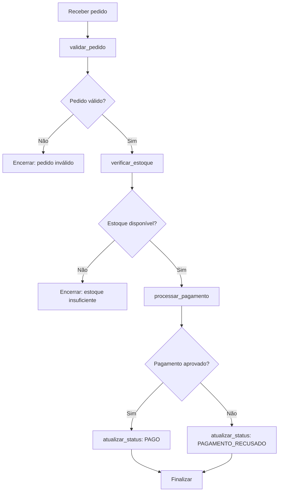

# Arquitetura do Assistente de Delivery

## Visão geral

O sistema utiliza uma arquitetura serverless na AWS. O AWS Step Functions coordena as etapas e invoca funções AWS Lambda. As funções consultam e atualizam dados no Amazon DynamoDB.

## Componentes

| Componente | Responsabilidade |
|---|---|
| Step Functions Standard | Orquestrar o processamento |
| Lambda `validar_pedido` | Validar dados e calcular total |
| Lambda `verificar_estoque` | Consultar disponibilidade dos produtos |
| Lambda `processar_pagamento` | Simular aprovação ou recusa |
| Lambda `atualizar_status` | Persistir o resultado na tabela Pedidos |
| DynamoDB `Pedidos` | Armazenar pedidos |
| DynamoDB `Produtos` | Armazenar catálogo e estoque |

## Fluxo

1. Receber evento de pedido.
2. Validar os dados.
3. Se inválido, encerrar com os erros.
4. Consultar estoque.
5. Se insuficiente, encerrar sem processar pagamento.
6. Simular pagamento.
7. Registrar `PAGO` ou `PAGAMENTO_RECUSADO`.
8. Retornar o resultado.

## Diagrama Mermaid

## Limitações conhecidas

O MVP não reserva nem desconta estoque. Também não possui API Gateway, interface, Bedrock, integração de pagamento real, idempotência ou mecanismo de compensação.
